# `flex/` cases

One chart per case (`./run.py plot`), a section per table of [the report](../report.md) except Layout only and Construction (their numbers are the segments of the construction+layout stack; Taffy is in the report only) and a bar per engine: bar = minimum of the samples in ms, whisker = all samples (thick p25–p75, median tick), construction+layout and whole-pipeline bars stacked by stage where the engine records them; label = ms, multiple of the fastest browser of the section, time per node.

## flex/huge_nested/1000

911 nodes.

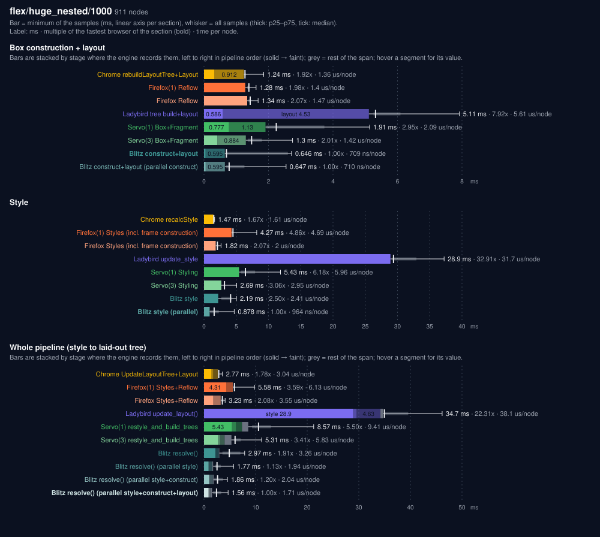

## flex/wide/1000

1000 nodes.

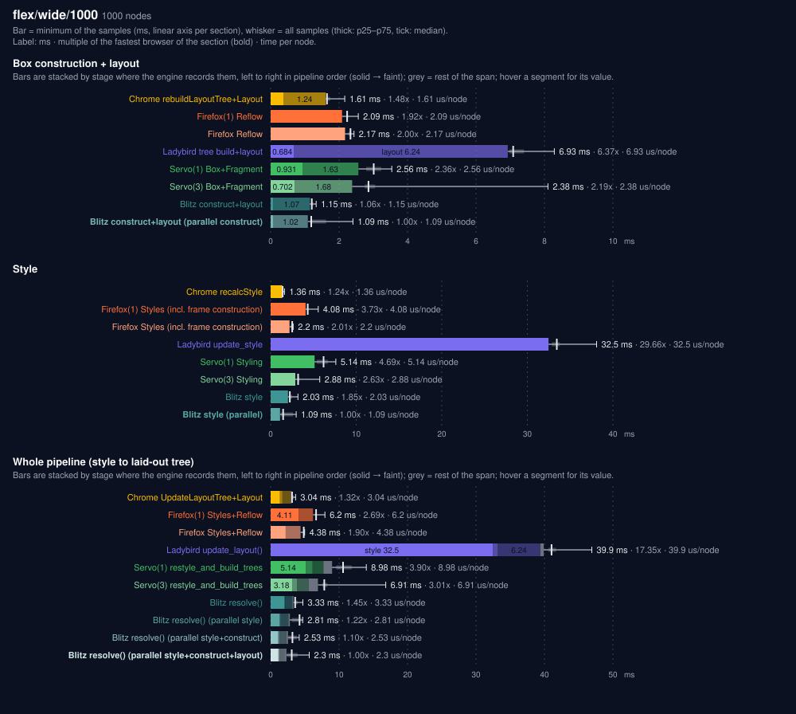

## flex/absolute/1000

1003 nodes.

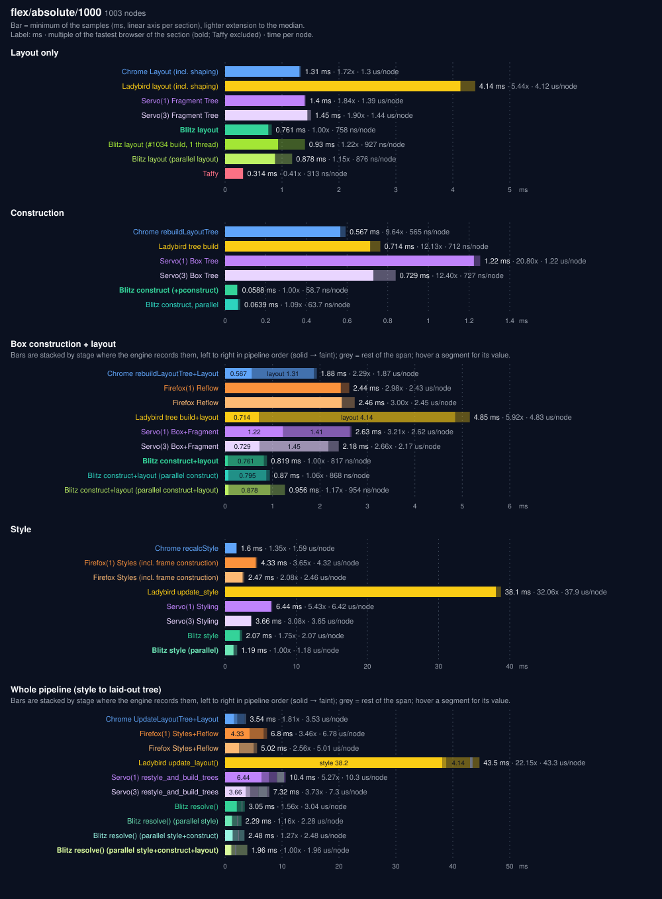

## flex/deep_auto/1000

767 nodes.

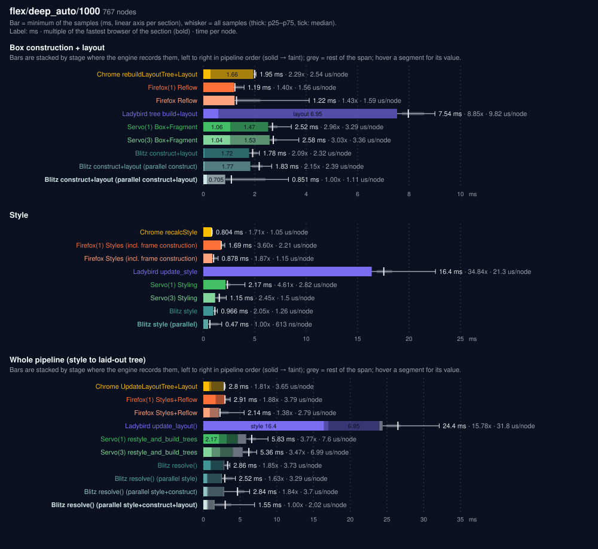

## flex/deep_random/1000

767 nodes.

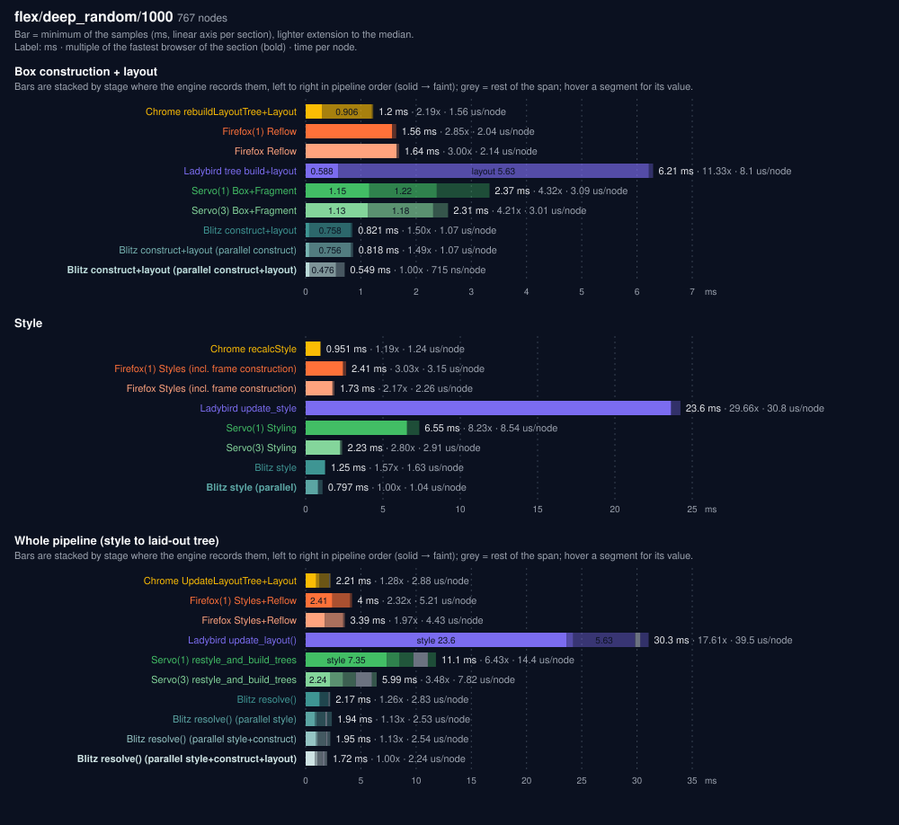

## flex/huge_nested/10000

9111 nodes.

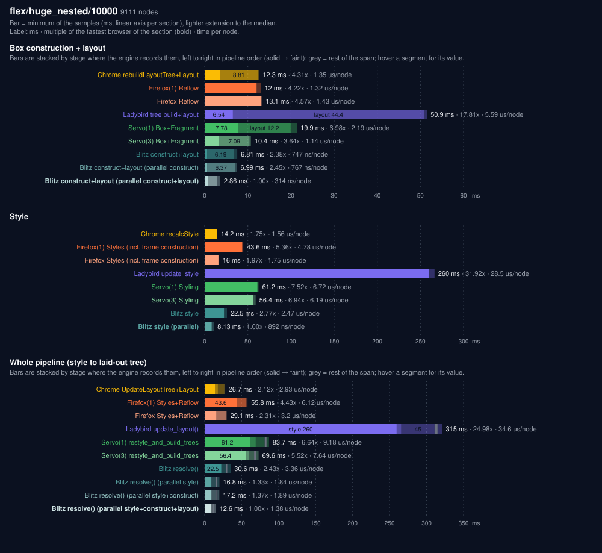

## flex/wide/10000

10001 nodes.

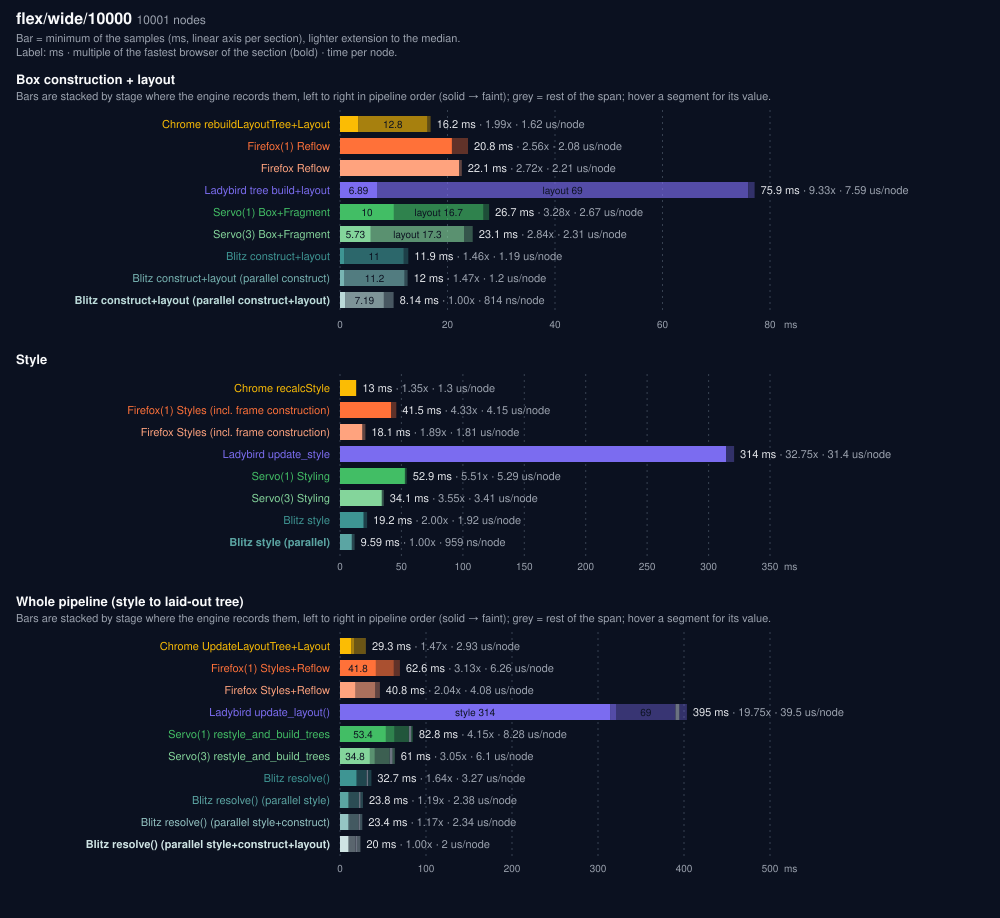

## flex/absolute/10000

10004 nodes.

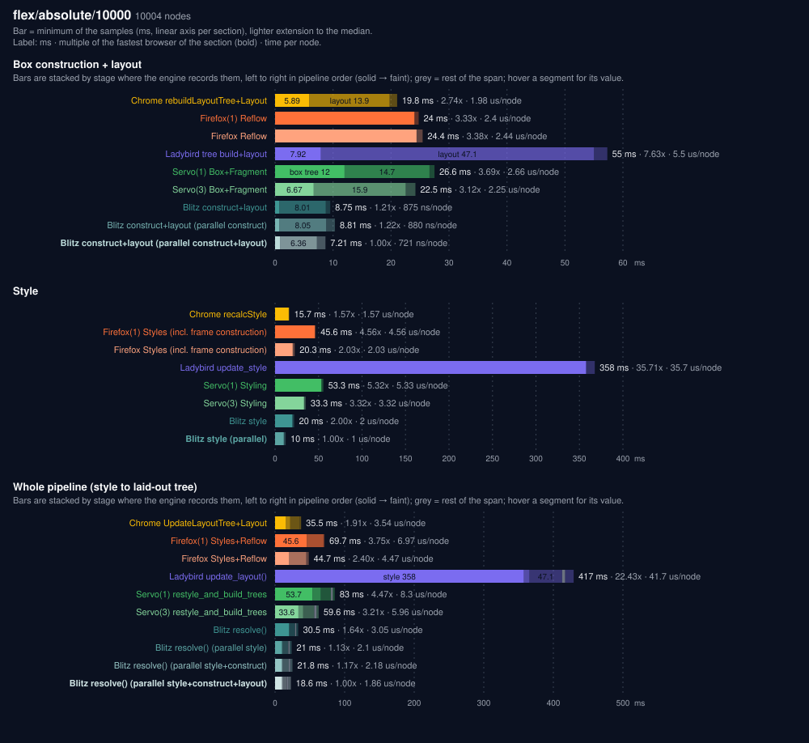

## flex/deep_auto/10000

8191 nodes.

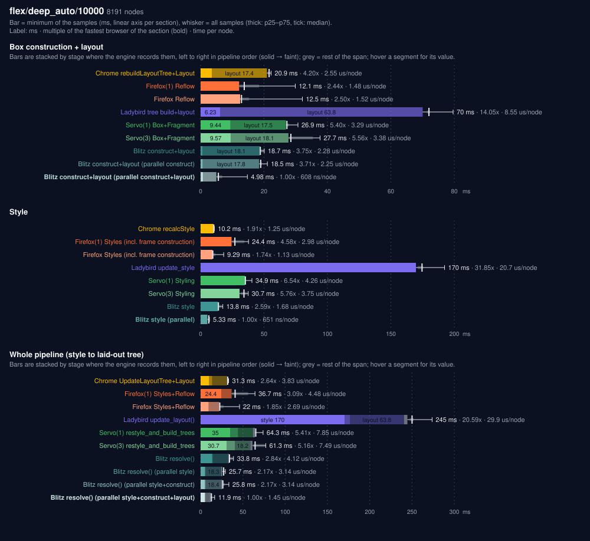

## flex/deep_random/10000

8191 nodes.

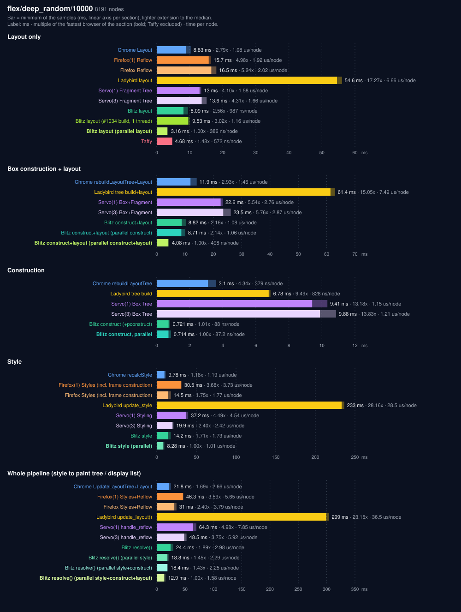

## flex/superdeep/50

151 nodes.

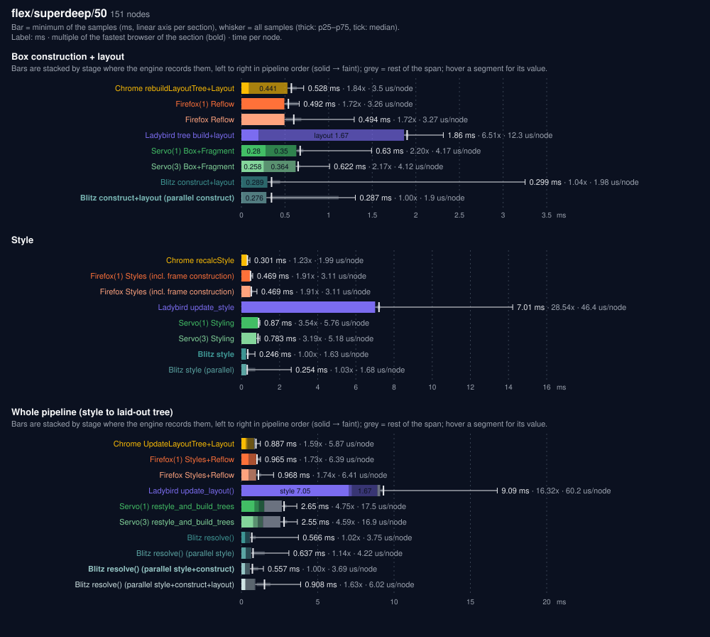

## flex/superdeep/100

301 nodes.

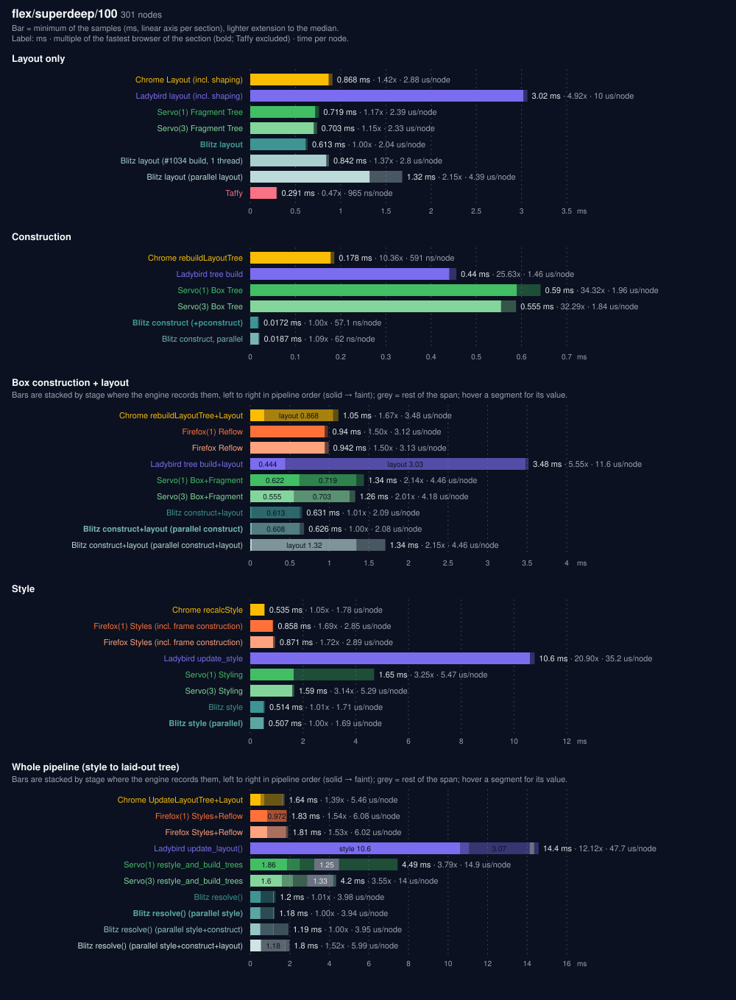
