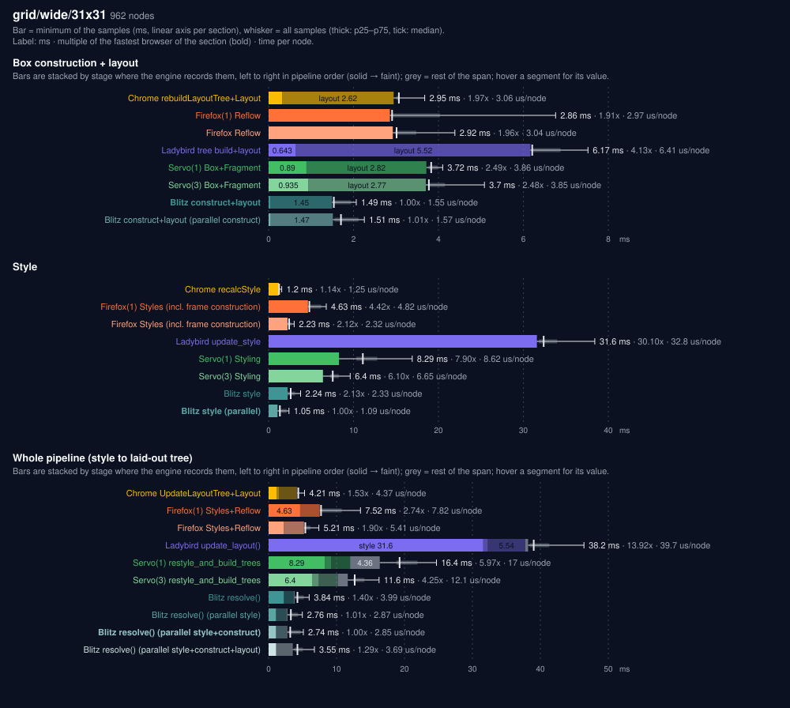
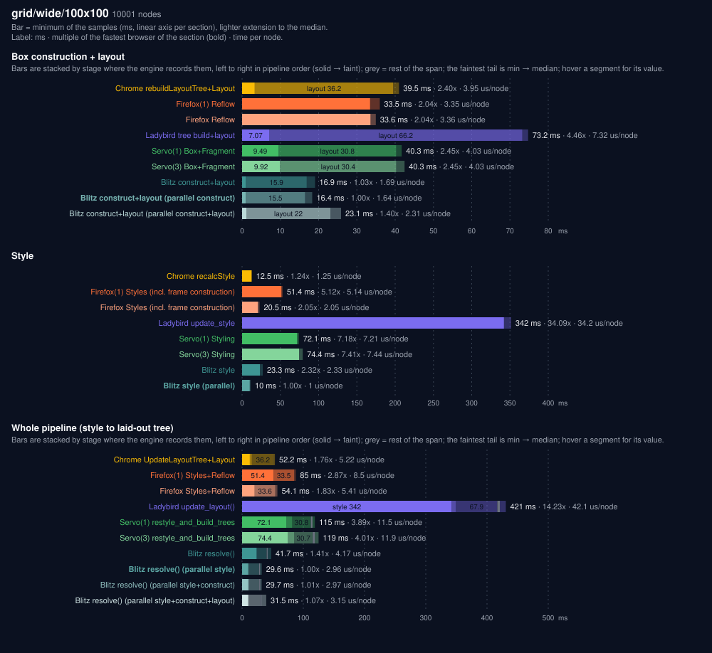
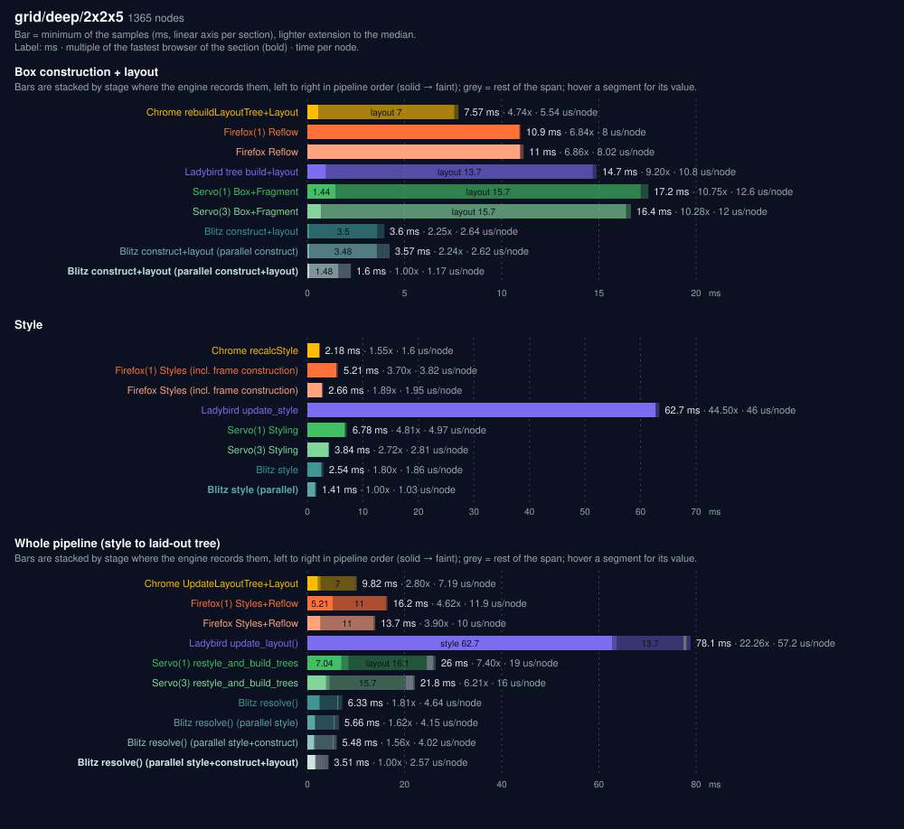
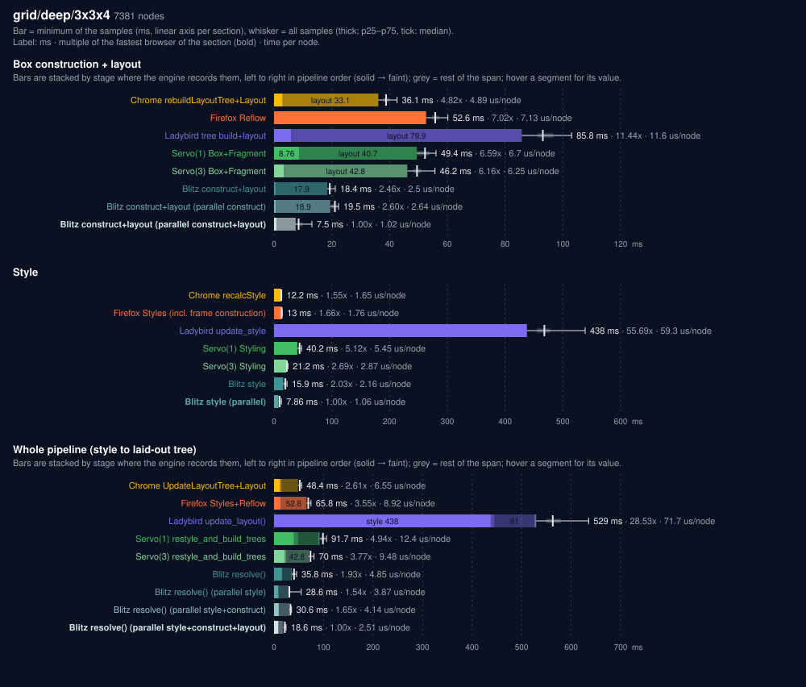
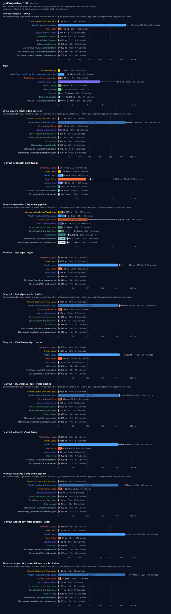

# `grid/` cases

One chart per case (`./run.py plot`), a section per table of [the report](../report.md) except Layout only and Construction (their numbers are the segments of the construction+layout stack; Taffy is in the report only) and a bar per engine: bar = minimum of the samples in ms, whisker = all samples (thick p25–p75, median tick), construction+layout and whole-pipeline bars stacked by stage where the engine records them; label = ms, multiple of the fastest browser of the section, time per node.

## grid/wide/31x31

962 nodes.

## grid/wide/100x100

10001 nodes.

## grid/deep/2x2x5

1365 nodes.

## grid/deep/3x3x4

7381 nodes.

## grid/superdeep/100

101 nodes.

