# `pangui/` cases

One chart per case (`./run.py plot`), a section per table of [the report](../report.md) and a bar per engine: bar = minimum of the samples in ms, lighter extension to the median, construction+layout and whole-pipeline bars stacked by stage where the engine records them; label = ms, multiple of the fastest browser of the section, time per node.

## pangui/expand_with_max_constraint

3001 nodes.

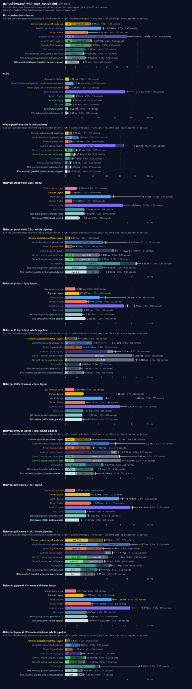

## pangui/expand_with_min_constraint

3001 nodes.

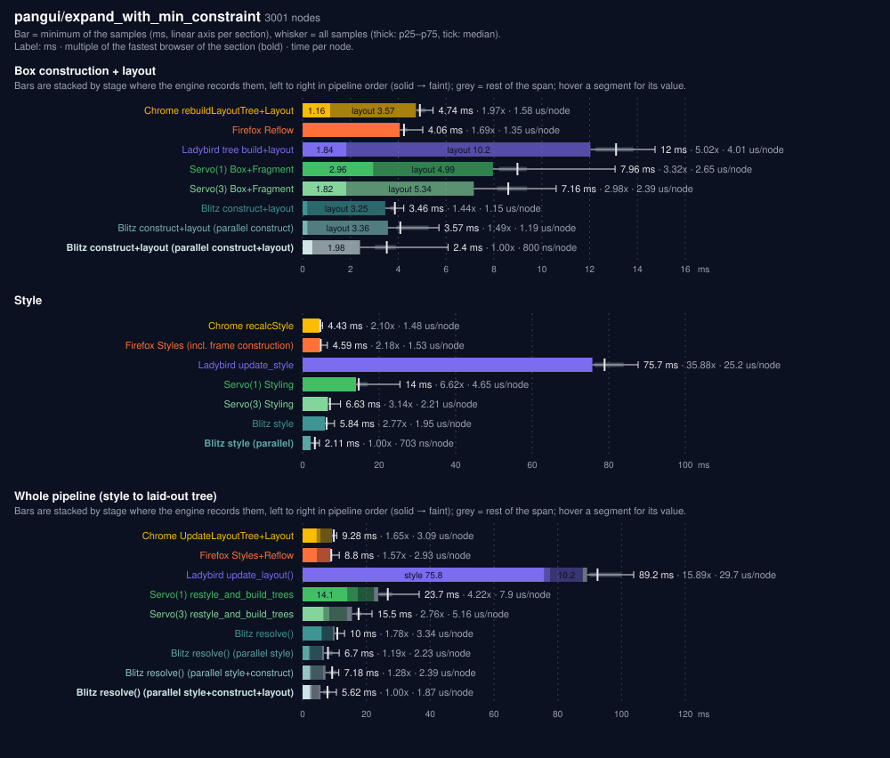

## pangui/fit_nesting

101111 nodes.

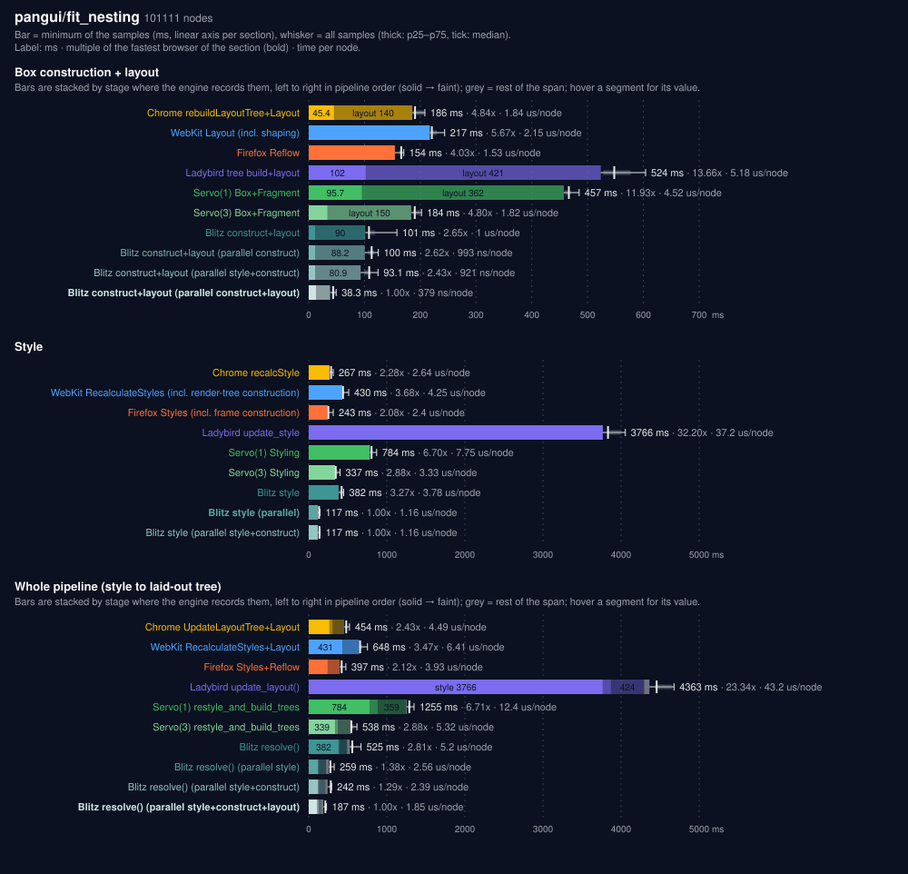

## pangui/flex_expand_equal_weights

15001 nodes.

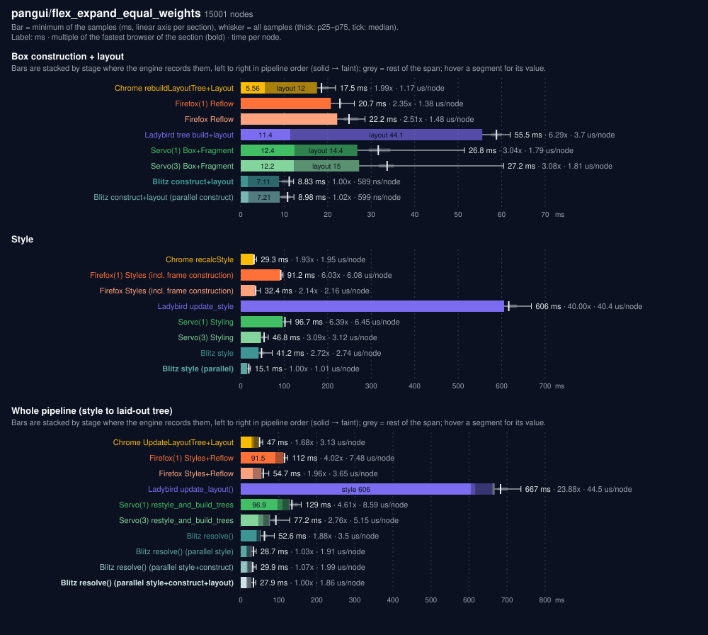

## pangui/flex_expand_weights

15001 nodes.

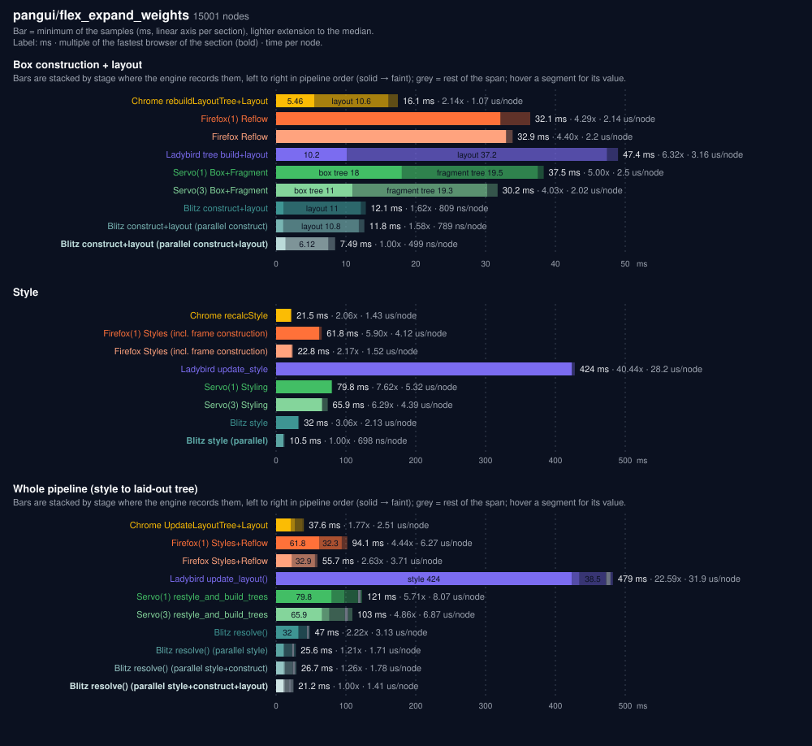

## pangui/nested_vertical_stack

10001 nodes.

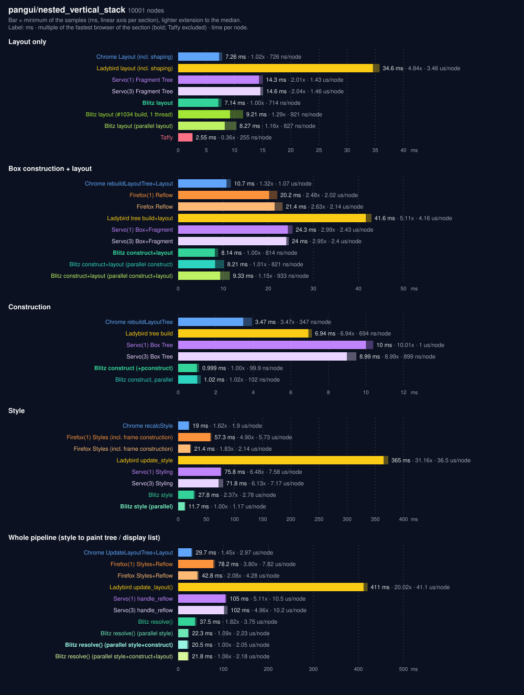

## pangui/padding_and_margin

101 nodes.

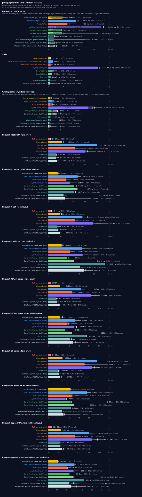

## pangui/percentage_and_ratio

10001 nodes.

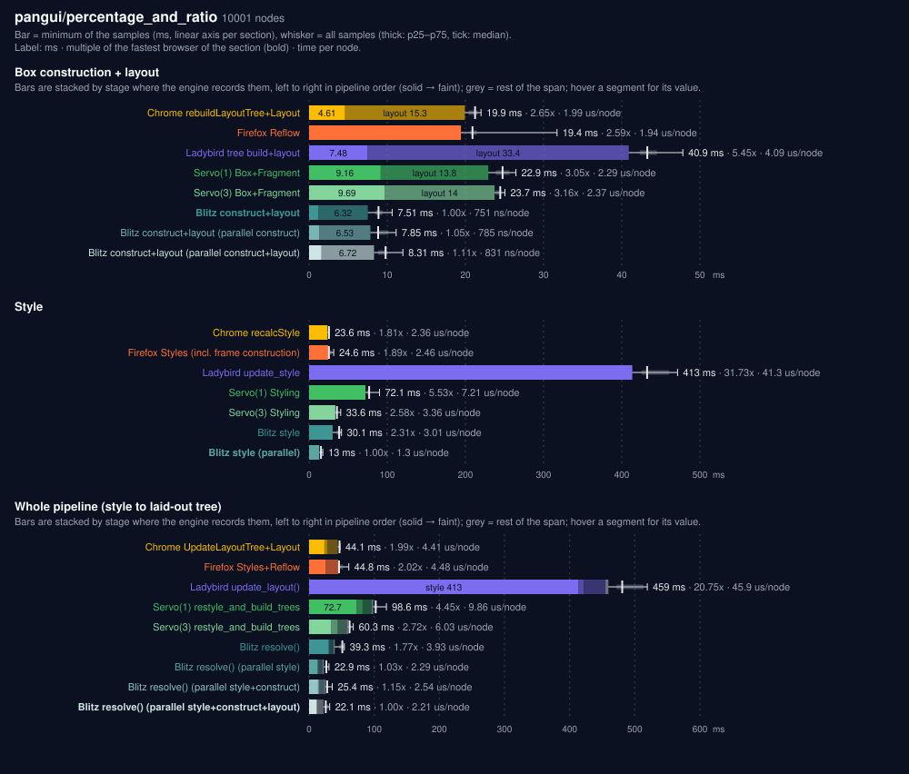

## pangui/perpendicular_expand_with_wrap

12001 nodes.

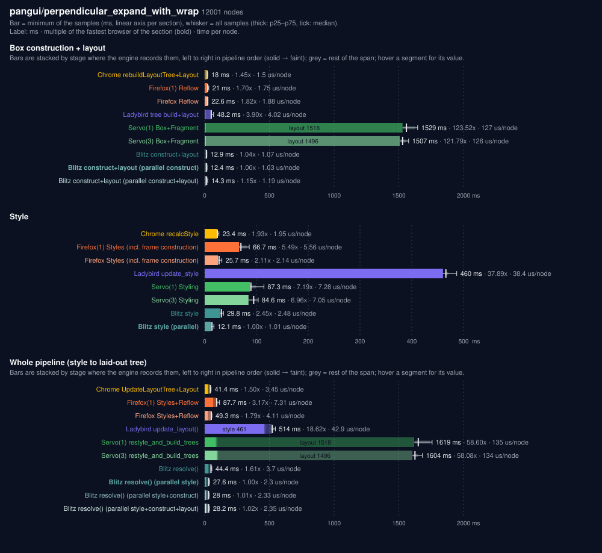

## pangui/pixels_with_min_expand_constraint

30001 nodes.

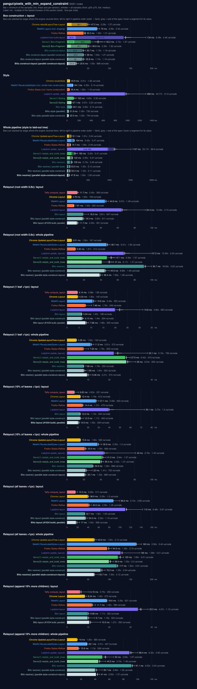

## pangui/wide_no_wrap_simple_few

1001 nodes.

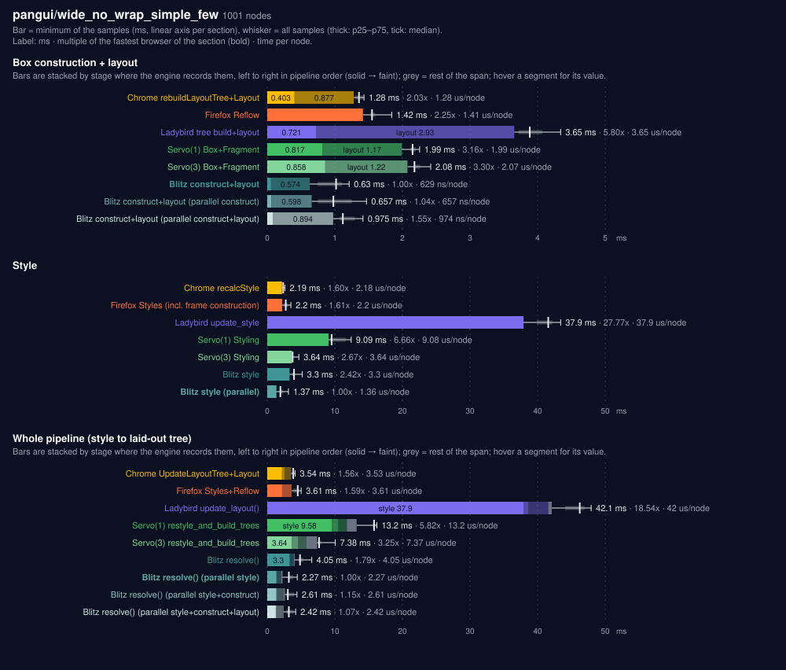

## pangui/wide_no_wrap_simple_many

100001 nodes.

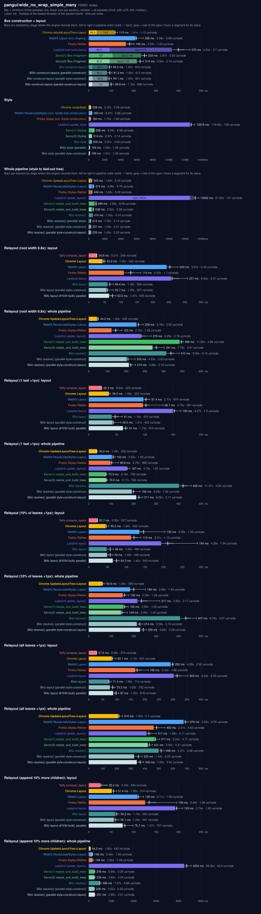

## pangui/wide_wrapping

10001 nodes.

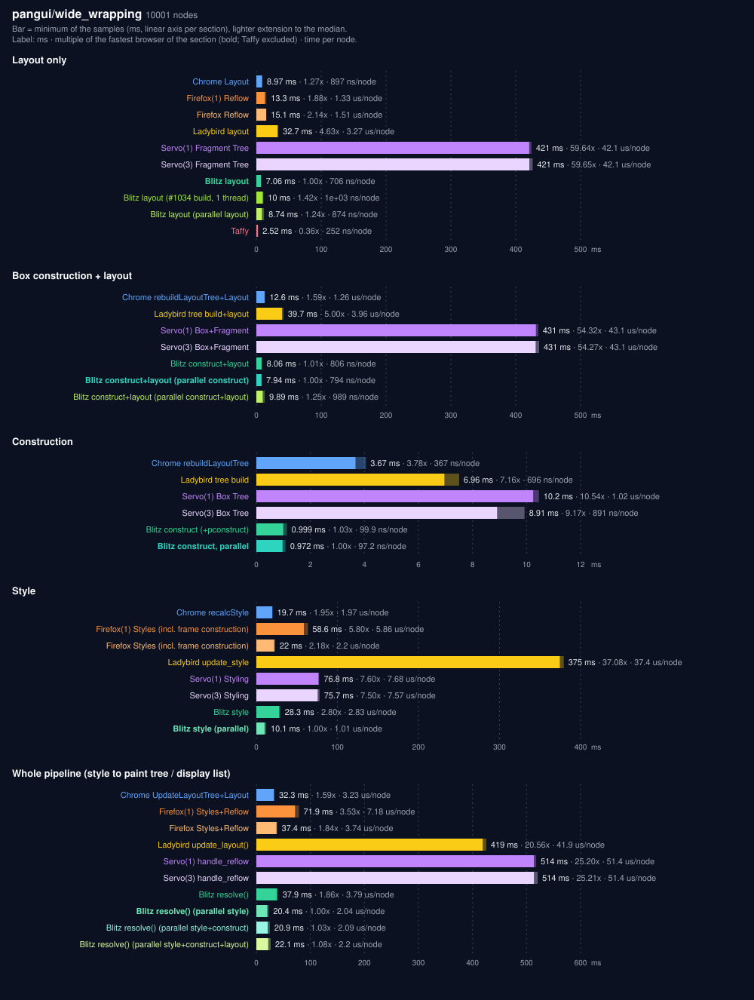
