# `real/` cases

One chart per case (`./run.py plot`), a section per table of [the report](../report.md) and a bar per engine: bar = minimum of the samples in ms, lighter extension to the median; label = ms, multiple of the fastest browser of the section, time per node.

## real/wikipedia

21889 nodes.

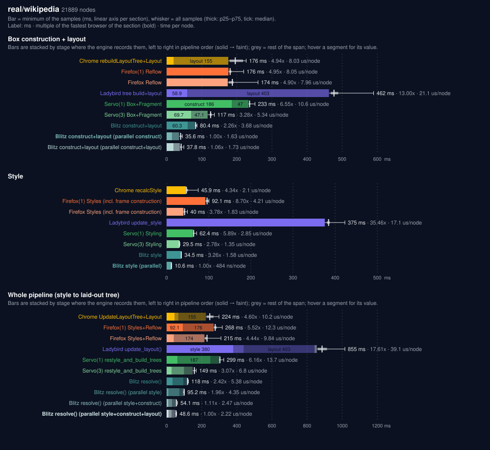

## real/wikipedia@1024

21889 nodes.

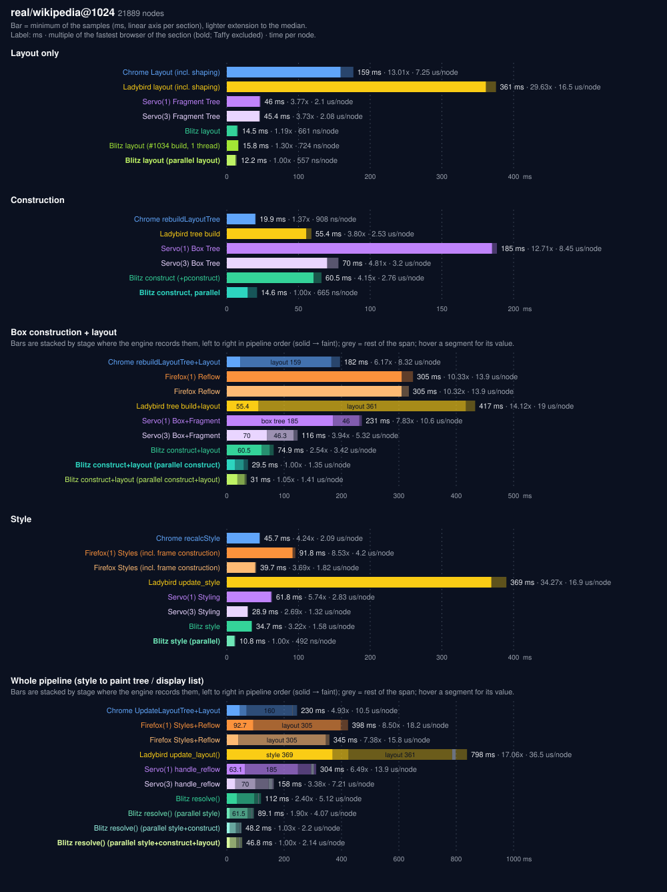

## real/mdn

2212 nodes.

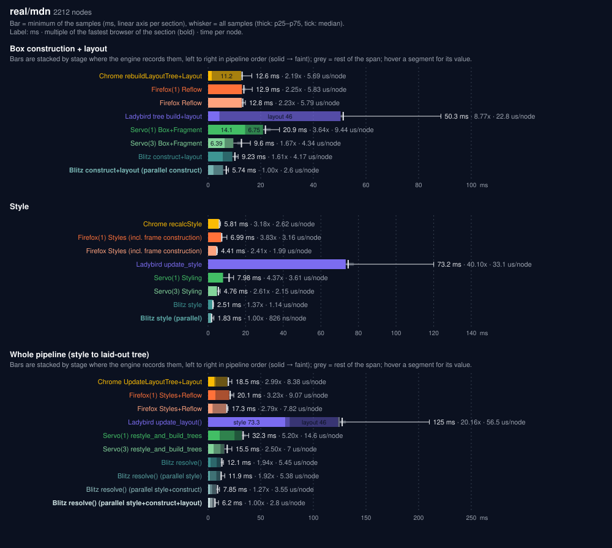

## real/mdn@1024

2212 nodes.

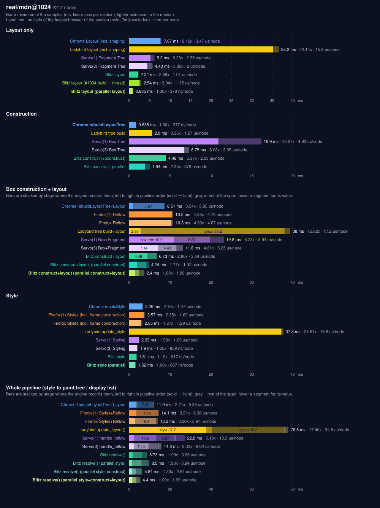

## real/rustdoc

15947 nodes.

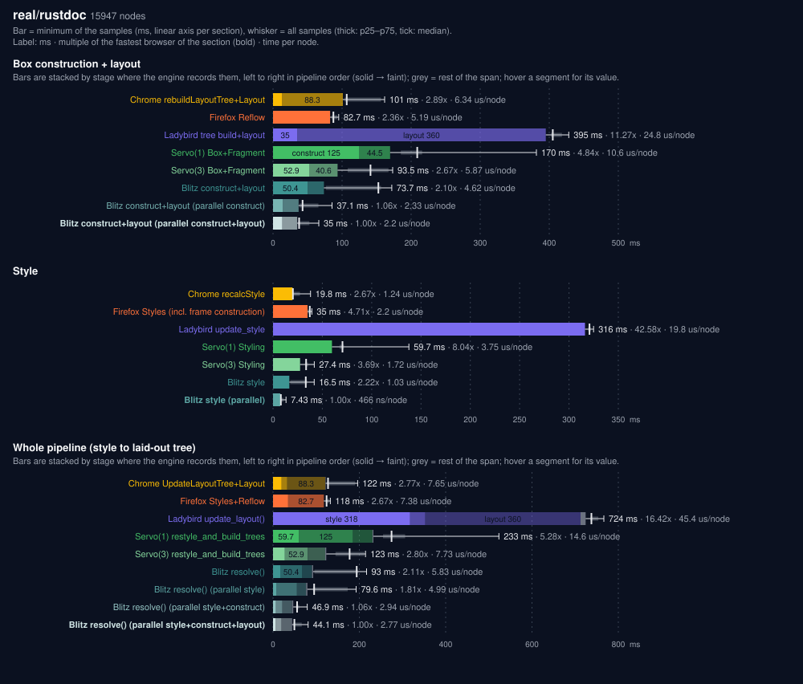

## real/css-flexbox-1

15890 nodes.

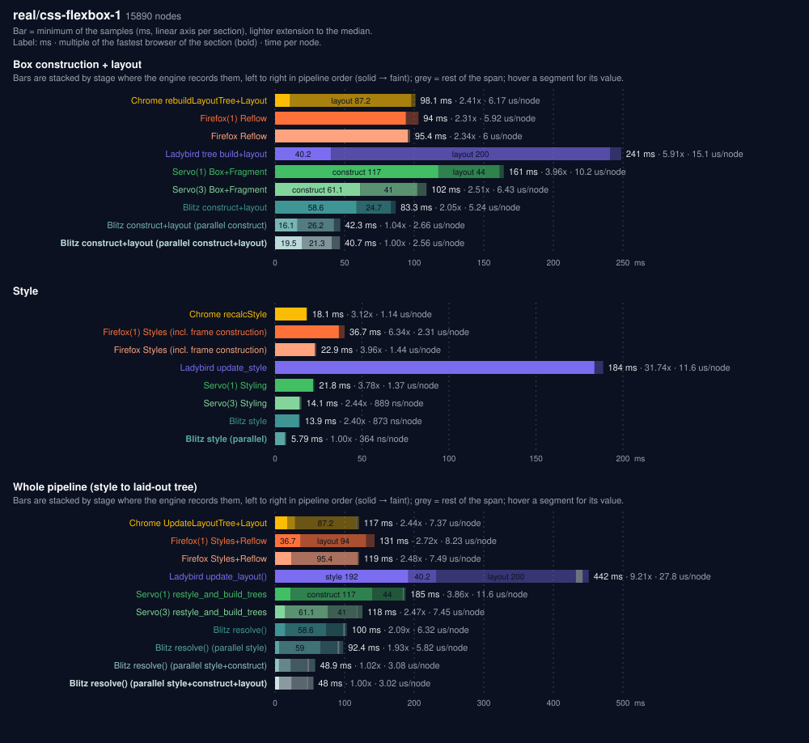

## real/servo-org

226 nodes.

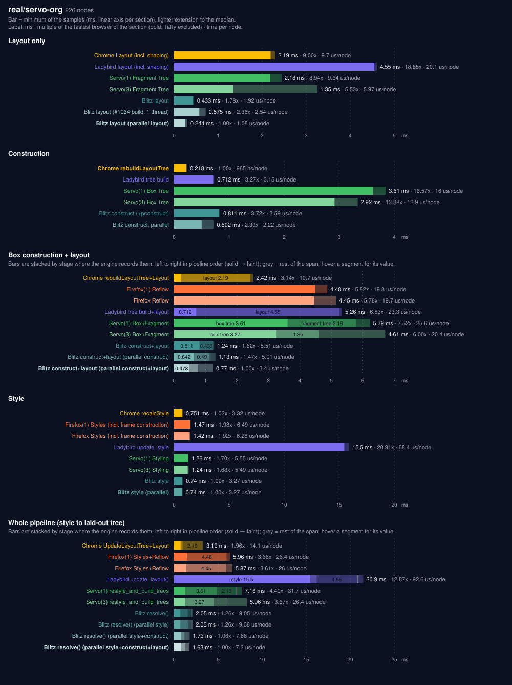

## real/servo-org@1024

226 nodes.

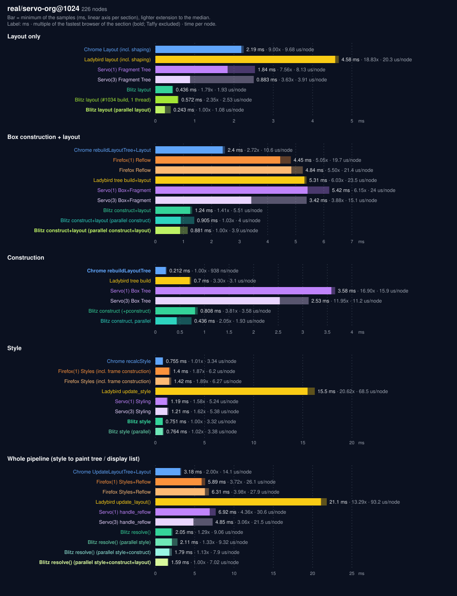

## real/dioxuslabs-com

158 nodes.

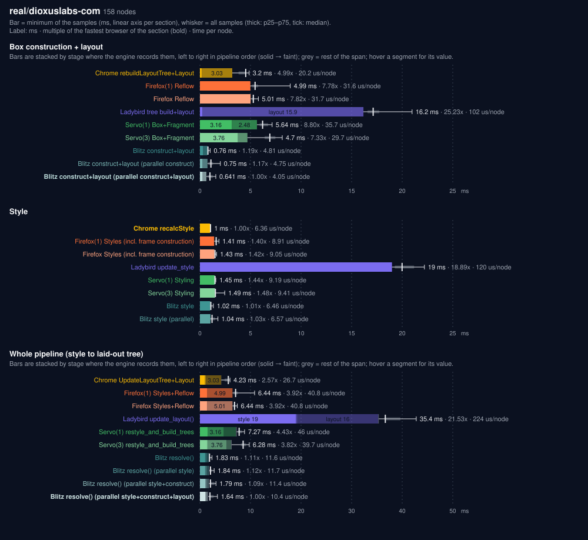

## real/dioxuslabs-com@1024

158 nodes.

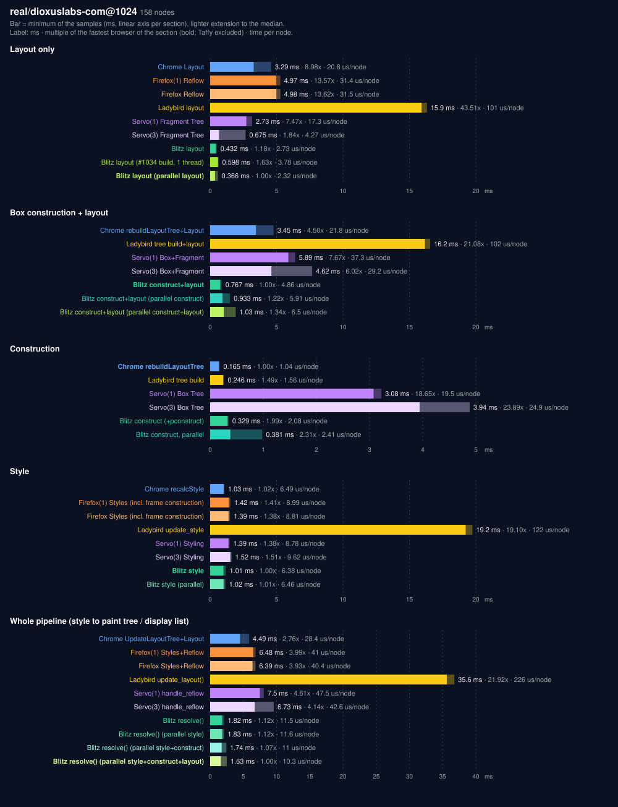

## real/bootstrap-dashboard

199 nodes.

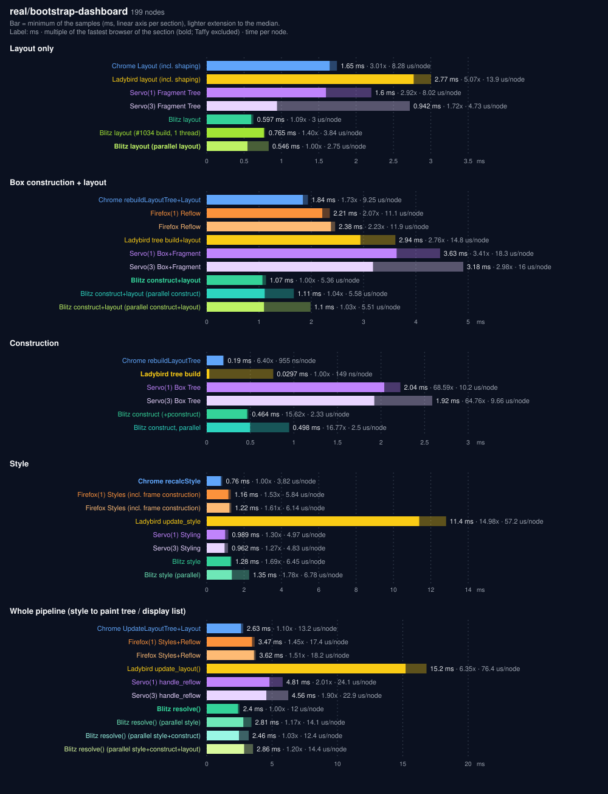

## real/bootstrap-dashboard@1024

199 nodes.

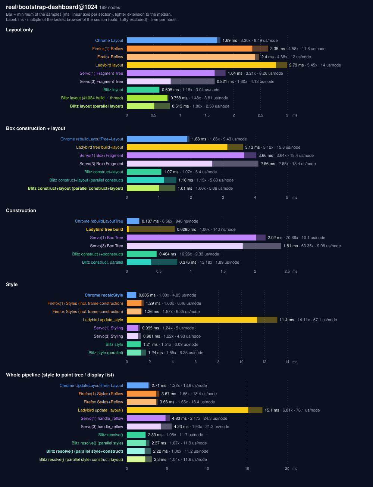
