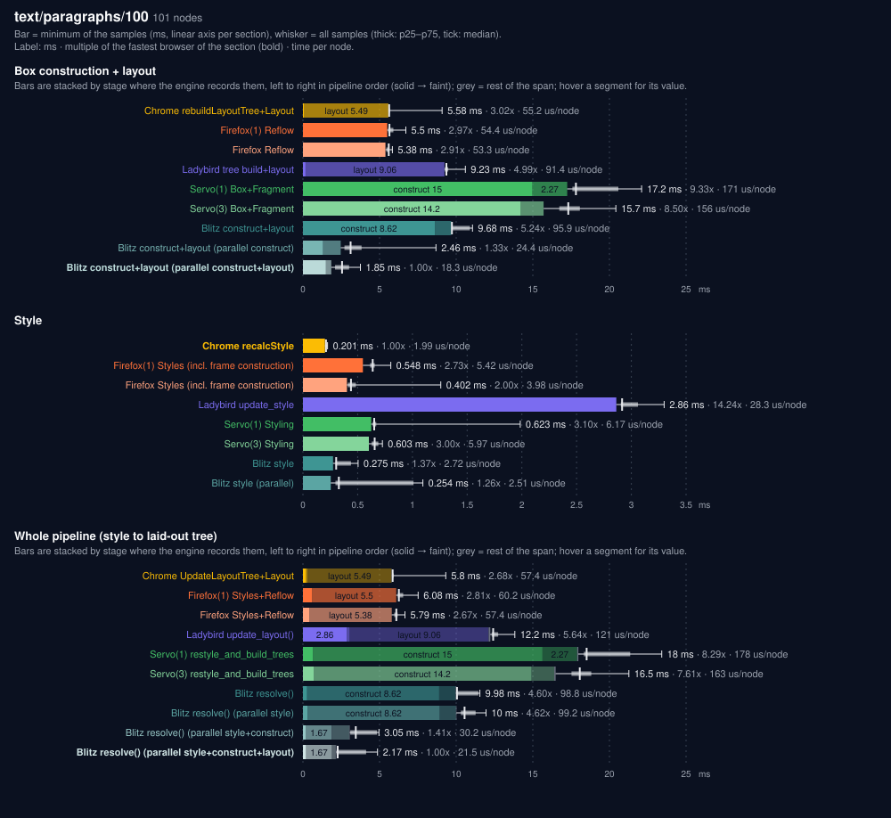
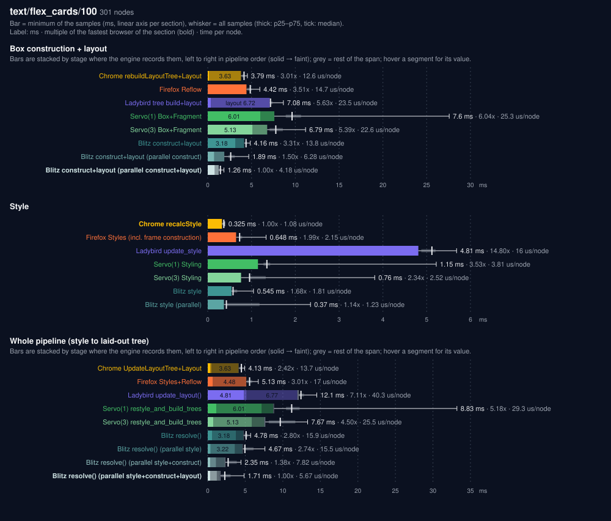
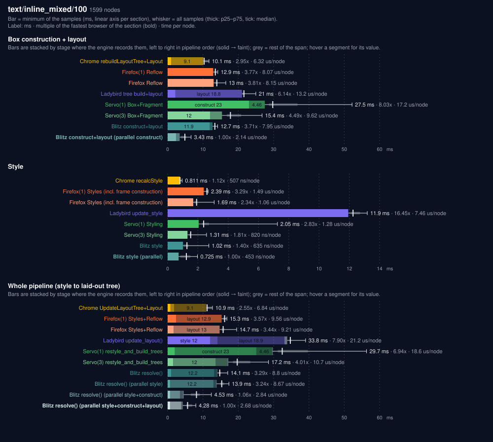
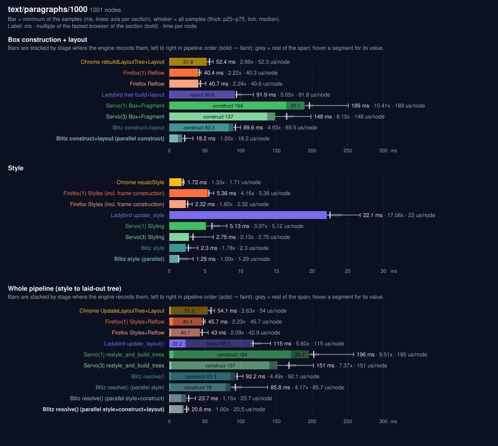
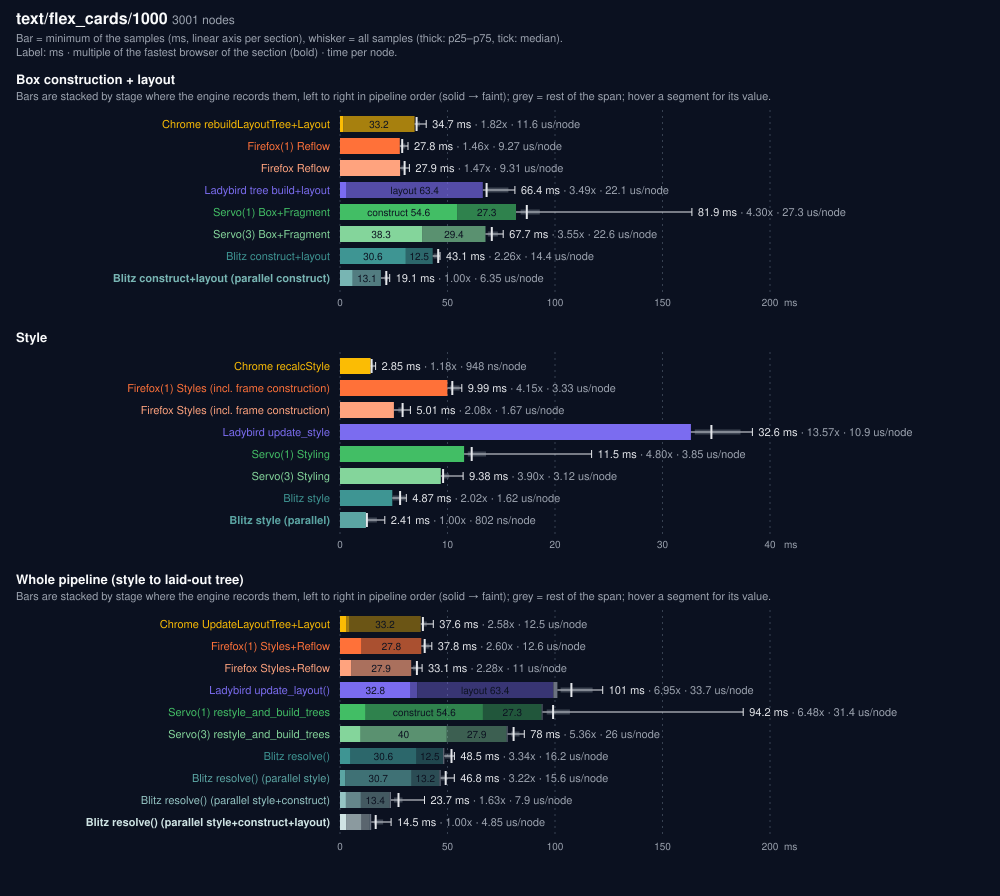
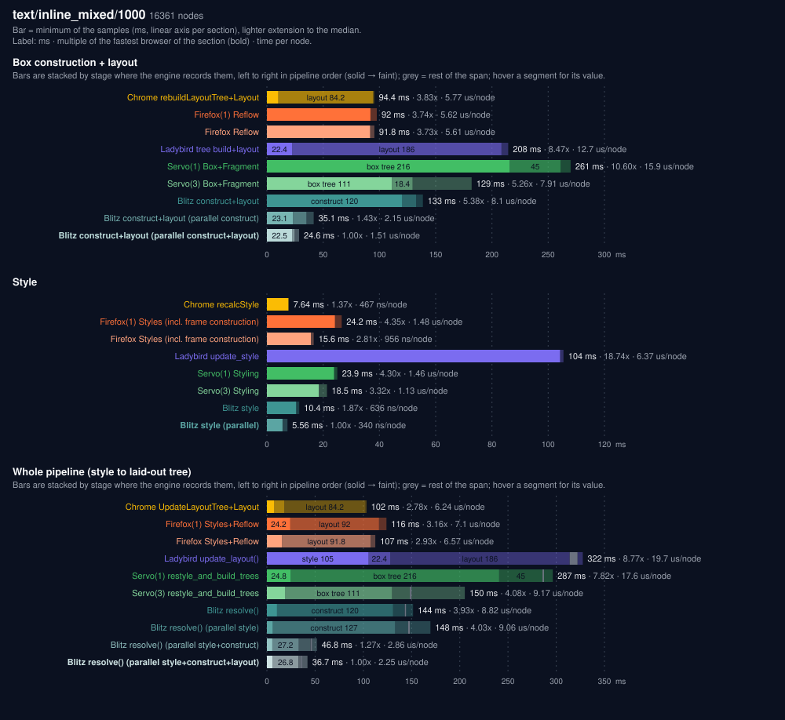

# `text/` cases

One chart per case (`./run.py plot`), a section per table of [the report](../report.md) except Layout only and Construction (their numbers are the segments of the construction+layout stack; Taffy is in the report only) and a bar per engine: bar = minimum of the samples in ms, lighter extension to the median, construction+layout and whole-pipeline bars stacked by stage where the engine records them; label = ms, multiple of the fastest browser of the section, time per node.

## text/paragraphs/100

101 nodes.

## text/flex_cards/100

301 nodes.

## text/inline_mixed/100

1599 nodes.

## text/paragraphs/1000

1001 nodes.

## text/flex_cards/1000

3001 nodes.

## text/inline_mixed/1000

16361 nodes.

